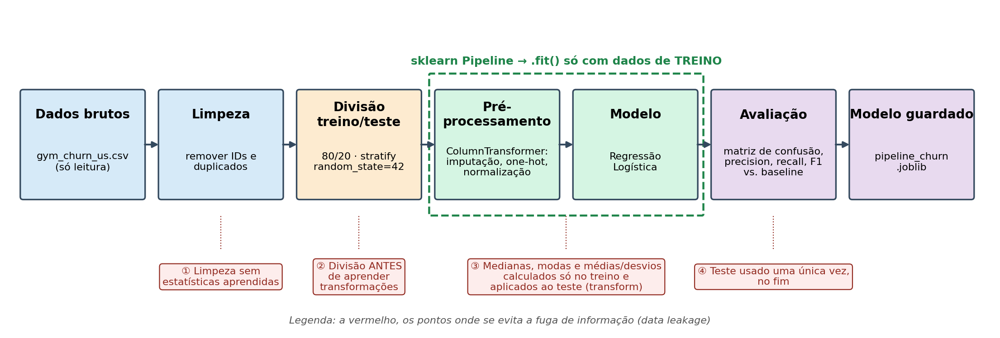

# Previsão de Churn de Clientes de um Ginásio

Pipeline reprodutível de dados e Machine Learning (pandas + scikit-learn) que prevê se um cliente
de um ginásio vai cancelar a subscrição no mês seguinte.

Projeto de Inteligência Artificial · CTeSP DAIA · IPGT · 2026/2027 — Alisson Alencar, Giuliana Finochio

## Dados

*Gym customers features and churn* — Kaggle (Adrian Vinueza), licença CC BY-NC-SA 4.0
<https://www.kaggle.com/datasets/adrianvinueza/gym-customers-features-and-churn>

O ficheiro original está em `data/gym_churn_us.csv` (4000 linhas, 14 colunas) e nunca é alterado pelo código.

## Como executar

```bash
python -m venv .venv
source .venv/bin/activate          # Windows: .venv\Scripts\activate
pip install -r requirements.txt
python pipeline_churn.py
```

O script corre do princípio ao fim sem intervenção manual (≈ 5 s) e gera:

| Ficheiro | Conteúdo |
|---|---|
| `models/pipeline_churn.joblib` | Pipeline completo (pré-processamento + Regressão Logística) |
| `outputs/metricas.json` | Precision, recall, F1, matriz de confusão (modelo e baseline) |
| `outputs/coeficientes.csv` / `.png` | Coeficientes ordenados por influência |
| `outputs/matriz_confusao.png` | Matrizes de confusão do baseline e do modelo |

Para regenerar o diagrama do pipeline: `python docs/diagrama_pipeline.py`.

### No Google Colab

Abrir `caso_estudo.ipynb` no Colab (*File → Upload notebook*) e fazer *Runtime → Run all*.
Se o CSV não estiver presente, o notebook descarrega-o automaticamente do Kaggle. O notebook tem o
mesmo pipeline que `pipeline_churn.py`, dividido em células explicadas, e produz os mesmos resultados.

## Usar o modelo guardado

```python
import joblib, pandas as pd
pipe = joblib.load("models/pipeline_churn.joblib")
novos = pd.read_csv("data/gym_churn_us.csv").drop(columns="Churn").head()
pipe.predict_proba(novos)[:, 1]   # probabilidade de churn
```

## Pipeline

dados brutos → limpeza → divisão treino/teste (80/20, `stratify`, `random_state=42`) →
`ColumnTransformer` (imputação, one-hot, normalização) → Regressão Logística → avaliação → `joblib`



## Resultados (conjunto de teste, 800 clientes)

| Modelo | Precision | Recall | F1 |
|---|---|---|---|
| Baseline (DummyClassifier) | 0,000 | 0,000 | 0,000 |
| Regressão Logística | 0,884 | 0,825 | 0,854 |

## Estrutura

```
caso_estudo_gym_churn/
├── data/gym_churn_us.csv          # dataset original (só leitura)
├── pipeline_churn.py              # código principal (script)
├── caso_estudo.ipynb              # mesmo pipeline em notebook (Colab)
├── models/pipeline_churn.joblib   # gerado
├── outputs/                       # métricas e gráficos gerados
├── docs/                          # diagrama e ficha de projeto / CRISP-DM
├── relatorio/                     # relatório final (.docx → exportar para PDF)
├── requirements.txt
└── README.md
```
